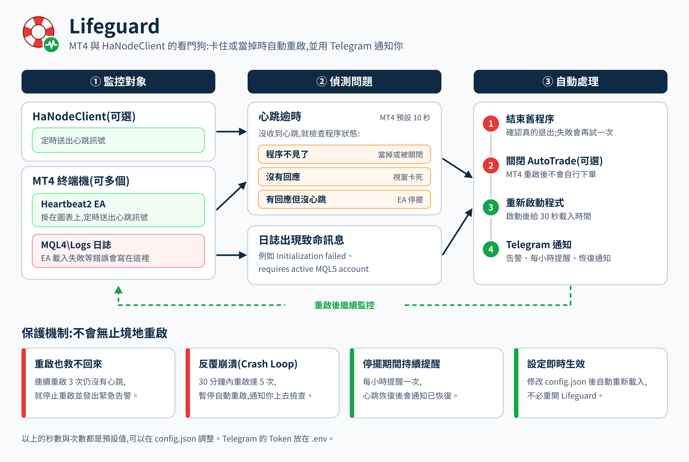
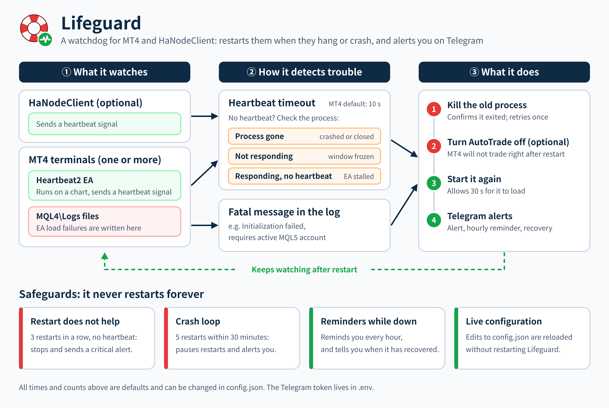

<p align="center"></p>
<h1 align="center">Lifeguard</h1>

<p align="center"><a href="#中文">中文</a> | <a href="#english">English</a></p>

---

## 中文

Lifeguard 是 MetaTrader 4 (MT4) 與 HaNodeClient 的看門狗。它在 Windows 上持續監控這些程式,卡住或當掉時自動重啟,並用 Telegram 通知你。



### 功能

- **心跳監控**:MT4 圖表上的 `Heartbeat2` EA 定時送出心跳。逾時沒收到,就判定為當掉、無回應或 EA 停擺,並重啟 MT4。
- **日誌監控**:監看 `MQL4\Logs`,出現 `Initialization failed` 或 `requires active MQL5 account` 時立即重啟。
- **HaNodeClient 監控**(可選):同樣以心跳判斷,逾時就重啟。
- **Telegram 通知**:告警、停擺期間每小時提醒、恢復通知。
- **保護機制**:連續重啟 3 次仍失敗,或 30 分鐘內重啟 5 次(Crash Loop),就暫停自動重啟並告警。
- **啟動前關閉 AutoTrade**(可選):重啟 MT4 前先把 AutoTrade 關掉,適合由 HaNodeClient 決定何時開啟交易的 HA 節點。
- **設定熱重載**:修改 `config.json` 後自動生效,不必重開。

### 系統需求

- Windows x64。`Lifeguard.exe` 是 Native AOT 編譯的單一執行檔,不需要安裝 .NET。
- MT4,並允許 EA 匯入 DLL(`Heartbeat2` 需要)。
- Lifeguard、MT4、HaNodeClient 必須在**同一個 Windows 登入工作階段**,而且**權限層級相同**(都是系統管理員,或都不是),否則收不到心跳。

### 安裝

1. 從 [Releases](../../releases) 下載 zip,解壓到一個資料夾,例如 `C:\MT4\Lifeguard`。
2. 把 `config.example.json` 複製成 `config.json`,填入每個 MT4 的 `ExePath` 與 `LogDirectory`。
3. 把 `.env.example` 複製成 `.env`,填入 Telegram 的 Bot Token 與 Chat ID(取得方式寫在檔案裡)。沒有 `.env` 也能執行,只是不會發通知。
4. 把 `mq4\Heartbeat2.mq4` 複製到 MT4 的 `MQL4\Experts`,編譯後掛到任一張圖表。EA 的 `InstanceID` 必須與 `config.json` 裡的實例名稱(例如 `MT4_01`)**完全相同**。
5. 執行 `Lifeguard.exe`。log 出現 `Monitoring activated` 就代表開始監控。
6. (建議)用系統管理員 PowerShell 執行 `tools\Install-LifeguardTask.ps1 -ExePath "C:\MT4\Lifeguard\Lifeguard.exe"`,建立工作排程:每 5 分鐘檢查一次,Lifeguard 沒在執行就啟動。

### 設定 (`config.json`)

| 欄位 | 預設值 | 說明 |
|---|---|---|
| `NodeId` | `LifeguardNode` | 節點名稱 |
| `MT4Instances` | 必填 | 要監控的 MT4:名稱對應 `ExePath` 與 `LogDirectory` |
| `HaNodeClient.ExePath` | 無 | 不填就不監控 HaNodeClient |
| `HaNodeClient.HeartbeatTimeoutMs` | `15000` | HaNodeClient 的心跳逾時 |
| `TimeoutMilliseconds` | `10000` | MT4 的心跳逾時 |
| `InitialDelayMs` | `30000` | Lifeguard 啟動後,開始監控前的等待時間 |
| `MaxRetries` | `3` | 連續重啟幾次仍失敗就停止重啟 |
| `RestartCooldownMs` | `15000` | 每次重啟後的冷卻時間 |
| `RestartStartupGraceMs` | `30000` | 重啟後等待第一個心跳的寬限期 |
| `RestartFlapWindowMs` | `1800000` | Crash Loop 的偵測視窗(30 分鐘) |
| `RestartFlapMaxCount` | `5` | 視窗內重啟達到這個次數就暫停重啟 |
| `AlertReminderIntervalMs` | `3600000` | 停擺期間的提醒間隔(1 小時) |
| `ForceAutoTradeOffOnStart` | `false` | 重啟 MT4 前先關閉 AutoTrade |
| `NotifyOnRecovery` | `true` | 恢復時發 Telegram 通知 |

`.env` 的設定優先於 `config.json`,而且不支援熱重載,修改後要重新啟動 Lifeguard。**不要把 `.env` 和 `config.json` 提交到 Git。**

### 附帶工具 (`tools\`)

| 檔案 | 用途 |
|---|---|
| `Install-LifeguardTask.ps1` | 建立 Lifeguard 的工作排程 |
| `manageLifeguard.bat` | 開啟或關閉 Lifeguard 保護的選單(需系統管理員) |
| `Start-MT4Safe.ps1` | 先關閉 AutoTrade 再啟動 MT4,已在執行的會跳過 |
| `Start-MT4_multi.bat` | 一次啟動多個 MT4 與 HaNodeClient(路徑要改成自己的) |

### 日誌

Lifeguard 的日誌在程式資料夾的 `Logs\`,每天一個檔案。

### 自行編譯

需要 .NET 10 SDK 與 Visual Studio 的「使用 C++ 的桌面開發」工作負載(Native AOT 需要)。

```
dotnet publish -c Release -r win-x64
```

推送 `v` 開頭的 tag(例如 `v1.0.1`)時,GitHub Actions 會自動編譯並建立 Release。

---

## English

Lifeguard is a watchdog for MetaTrader 4 (MT4) and HaNodeClient. It runs on Windows, restarts these programs when they hang or crash, and alerts you on Telegram.



### Features

- **Heartbeat monitoring**: the `Heartbeat2` EA on an MT4 chart sends a heartbeat at a fixed interval. If it stops, Lifeguard treats MT4 as crashed, frozen or stalled and restarts it.
- **Log monitoring**: watches `MQL4\Logs` and restarts MT4 as soon as `Initialization failed` or `requires active MQL5 account` appears.
- **HaNodeClient monitoring** (optional): the same heartbeat check, with its own timeout.
- **Telegram alerts**: an alert on failure, an hourly reminder while down, and a recovery notice.
- **Safeguards**: after 3 failed restarts in a row, or 5 restarts within 30 minutes (crash loop), automatic restarts are suspended and you are alerted.
- **AutoTrade off before start** (optional): turns AutoTrade off before MT4 is restarted. Useful on HA nodes where HaNodeClient decides when trading is enabled.
- **Live configuration**: changes to `config.json` take effect without a restart.

### Requirements

- Windows x64. `Lifeguard.exe` is a single Native AOT executable; no .NET installation is needed.
- MT4 with DLL imports allowed for EAs (required by `Heartbeat2`).
- Lifeguard, MT4 and HaNodeClient must run in the **same Windows logon session** and at the **same privilege level** (all elevated, or none). Otherwise the heartbeats are not received.

### Installation

1. Download the zip from [Releases](../../releases) and extract it to a folder such as `C:\MT4\Lifeguard`.
2. Copy `config.example.json` to `config.json` and set `ExePath` and `LogDirectory` for each MT4.
3. Copy `.env.example` to `.env` and fill in your Telegram bot token and chat ID (the file explains how to get them). Without `.env` Lifeguard still runs but sends no alerts.
4. Copy `mq4\Heartbeat2.mq4` to the MT4 `MQL4\Experts` folder, compile it and attach it to any chart. The EA's `InstanceID` must match the instance name in `config.json` (for example `MT4_01`) **exactly**.
5. Run `Lifeguard.exe`. Monitoring has started when the log shows `Monitoring activated`.
6. (Recommended) In an elevated PowerShell, run `tools\Install-LifeguardTask.ps1 -ExePath "C:\MT4\Lifeguard\Lifeguard.exe"`. It creates a scheduled task that checks every 5 minutes and starts Lifeguard if it is not running.

### Configuration (`config.json`)

| Key | Default | Description |
|---|---|---|
| `NodeId` | `LifeguardNode` | Name of this node |
| `MT4Instances` | required | MT4 terminals to watch: name mapped to `ExePath` and `LogDirectory` |
| `HaNodeClient.ExePath` | none | Leave empty to skip HaNodeClient monitoring |
| `HaNodeClient.HeartbeatTimeoutMs` | `15000` | Heartbeat timeout for HaNodeClient |
| `TimeoutMilliseconds` | `10000` | Heartbeat timeout for MT4 |
| `InitialDelayMs` | `30000` | Wait after Lifeguard starts before monitoring begins |
| `MaxRetries` | `3` | Failed restarts in a row before restarts stop |
| `RestartCooldownMs` | `15000` | Cooldown after each restart |
| `RestartStartupGraceMs` | `30000` | Grace period for the first heartbeat after a restart |
| `RestartFlapWindowMs` | `1800000` | Crash-loop detection window (30 minutes) |
| `RestartFlapMaxCount` | `5` | Restarts within the window before restarts are suspended |
| `AlertReminderIntervalMs` | `3600000` | Reminder interval while down (1 hour) |
| `ForceAutoTradeOffOnStart` | `false` | Turn AutoTrade off before restarting MT4 |
| `NotifyOnRecovery` | `true` | Send a Telegram message on recovery |

Values in `.env` override `config.json`. `.env` is not reloaded live; restart Lifeguard after changing it. **Never commit `.env` or `config.json` to Git.**

### Bundled tools (`tools\`)

| File | Purpose |
|---|---|
| `Install-LifeguardTask.ps1` | Creates the Lifeguard scheduled task |
| `manageLifeguard.bat` | Menu to turn Lifeguard protection on or off (run as administrator) |
| `Start-MT4Safe.ps1` | Turns AutoTrade off, then starts MT4; skips terminals already running |
| `Start-MT4_multi.bat` | Starts several MT4 terminals and HaNodeClient (edit the paths first) |

### Logs

Lifeguard writes its own logs to `Logs\` in the program folder, one file per day.

### Building from source

Requires the .NET 10 SDK and the Visual Studio "Desktop development with C++" workload (needed for Native AOT).

```
dotnet publish -c Release -r win-x64
```

Pushing a tag that starts with `v` (for example `v1.0.1`) makes GitHub Actions build the executable and create a Release.
